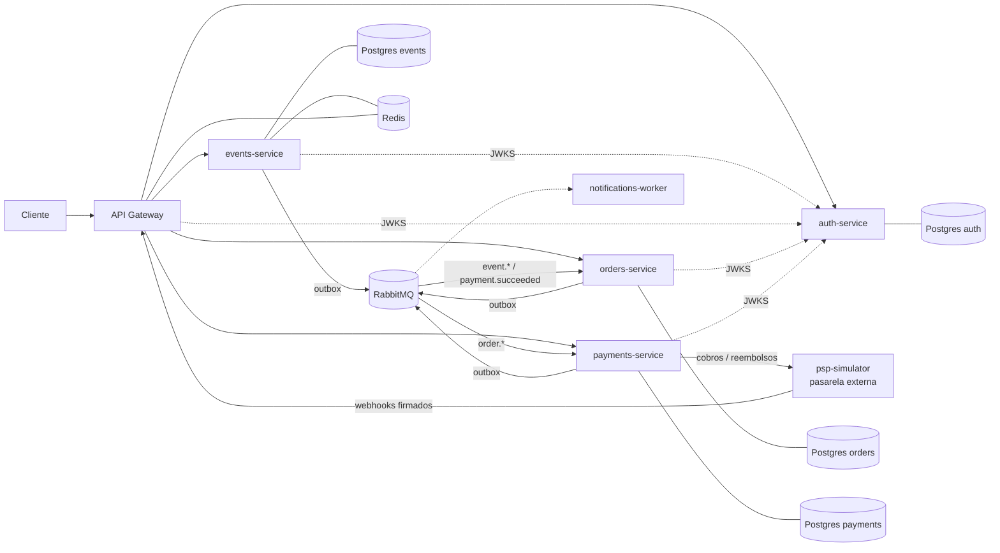
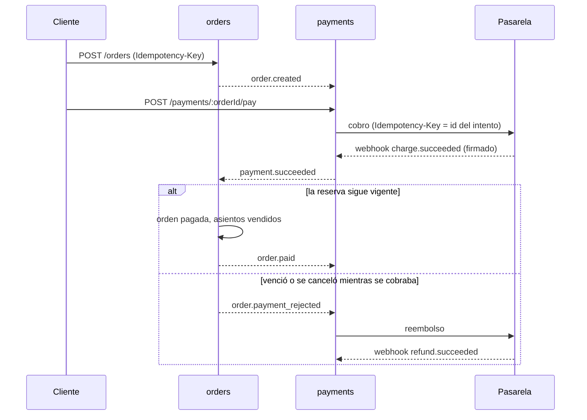

# TicketFlow

Backend de una plataforma de venta de entradas para eventos, construido con **microservicios en Node.js + TypeScript**.

El problema central es el mismo que enfrentan Ticketmaster o Passline: miles de personas intentando comprar **los mismos asientos al mismo tiempo**, sin sobreventa, con pagos que pueden fallar a mitad de camino y servicios que se caen.

Todo corre localmente con Docker y **no requiere ningún servicio pago**.

## Arquitectura



| Servicio | Estado | Responsabilidad |
|---|---|---|
| `api-gateway` | ✅ | Punto de entrada único: ruteo, validación de JWT, rate limiting distribuido, CORS |
| `auth-service` | ✅ | Registro, login, JWT firmados con Ed25519, rotación de refresh tokens |
| `events-service` | ✅ | Eventos y sectores, caché en Redis, publica eventos de dominio vía outbox |
| `orders-service` | ✅ | Inventario de asientos, reservas con vencimiento, cero sobreventa, idempotencia |
| `payments-service` | ✅ | Cobros, webhooks firmados, conciliación, reembolsos (saga de compra) |
| `psp-simulator` | ✅ | Pasarela de pagos externa simulada: tarjetas de prueba, webhooks con reintentos, fallas inyectables |
| `notifications-worker` | 🔜 | Emails con entrada + QR, reintentos con backoff y dead-letter queue |

## La saga de compra

No hay transacciones distribuidas: cada servicio commitea en su base y avisa por RabbitMQ (outbox). Cuando algo sale mal, se **compensa**.



| Qué falla | Qué pasa |
|---|---|
| La tarjeta es rechazada | El pago vuelve a "esperando pago"; el cliente reintenta con otra tarjeta mientras la reserva siga vigente |
| El cliente hace doble click en "pagar" | Una sola llamada llega a la pasarela (lock + índice único parcial: nunca dos cobros en curso) |
| La pasarela no responde | El cobro queda "en duda" y no se marca como fallido a ciegas. La conciliación consulta a la pasarela y lo resuelve |
| El webhook se pierde | La conciliación consulta los cobros sin respuesta y aplica el resultado |
| El webhook llega duplicado | Se descarta por id de evento, en la misma transacción que el efecto |
| El pago llega cuando la reserva ya venció | orders lo rechaza y payments reembolsa (verificado de punta a punta en Docker) |
| Se cancela el evento | Las órdenes pendientes se anulan y las pagadas se reembolsan |

## Decisiones técnicas destacadas

### payments-service
- **Webhooks firmados** con HMAC-SHA256 sobre `timestamp.body crudo` (estilo Stripe).
  - Comparación en tiempo constante y tolerancia de 5 minutos contra replay attacks.
  - Se verifica el body crudo, por eso el endpoint tiene su propio parser.
- **Nunca se confía en el monto del webhook:** si no coincide con la orden, el pago no se confirma y se reembolsa.
- **Nunca una transacción abierta durante una llamada HTTP.** Primero se registra el intento de cobro (commit) y después se llama a la pasarela. Si el proceso muere en el medio, la conciliación lo resuelve.
- **Idempotencia hacia afuera:** cada llamada a la pasarela lleva una `Idempotency-Key` estable, así reintentar un timeout nunca cobra dos veces.
  - El cliente HTTP distingue errores definitivos (4xx) de resultados desconocidos (timeout o 5xx).
- **Reembolsos con "reclamar y después llamar":** el job marca el pago (`FOR UPDATE SKIP LOCKED`), commitea y recién después llama a la pasarela. Si falla, se reintenta.
- **Máquina de estados explícita** (`awaiting_payment → processing → succeeded → refund_pending → refunded`, o `voided`), con transiciones idempotentes.
- **Datos de tarjeta:** solo se guardan los últimos 4 dígitos. En producción se usaría la tokenización de la pasarela y el número nunca pasaría por el backend.

### psp-simulator
Sustituye a Mercado Pago o Stripe para poder probar las fallas a voluntad:

| Tarjeta | Resultado |
|---|---|
| `4242424242424242` | Aprobada |
| `4000000000000002` | Rechazada |
| `4000000000009995` | Fondos insuficientes |
| `4000000000000077` | Aprobada, webhook duplicado |
| `4000000000000101` | Aprobada, webhook perdido (requiere conciliación) |

Además reintenta los webhooks con backoff exponencial y, con `PSP_ERROR_RATE`, responde 503 al azar.

### orders-service: vender sin sobreventa
- **Inventario propio construido por eventos.** Consume `event.published` y genera una fila por asiento (`generate_series`, un INSERT por sector). No consulta a events-service al vender: si events se cae, la venta sigue.
- **Cero sobreventa.** Los asientos pedidos se bloquean con `SELECT ... FOR UPDATE` dentro de la transacción de compra. Es todo o nada: si uno no está libre, no se reserva ninguno.
  - Un test dispara 50 compras simultáneas del mismo asiento y verifica que gana exactamente una.
  - Otro lanza 100 compradores con pedidos superpuestos en orden aleatorio y verifica que ningún asiento queda en dos órdenes.
- **Sin deadlocks.** Los locks se toman siempre en el mismo orden (`ORDER BY id`), así dos compras que piden [A, B] y [B, A] nunca se bloquean mutuamente.
- **La base protege invariantes** con `CHECK`: un asiento disponible no tiene orden y uno retenido tiene vencimiento. Un bug en el código no puede dejar datos inconsistentes.
- **Reservas con vencimiento.** La orden queda `pending_payment` con un plazo (10 min por defecto).
  - Un asiento con la reserva vencida cuenta como libre al instante, aunque el job todavía no haya pasado.
  - Un job periódico (`FOR UPDATE SKIP LOCKED`, seguro con varias réplicas) cierra esas órdenes y emite `order.expired`.
- **`Idempotency-Key` obligatoria** al comprar. Un reintento devuelve la misma orden con `idempotent-replayed: true`.
  - Dos requests simultáneas con la misma clave se serializan sobre la clave primaria y crean una sola orden.
  - La misma clave con otro pedido responde 422. Las claves son por usuario.
  - Si la compra falla, la clave queda libre para reintentar.
- **Consumidor idempotente (inbox):** el `messageId` se registra en la misma transacción que el efecto, así un mensaje repetido no duplica asientos.
- **Lector tolerante:** valida solo los campos que usa del mensaje. Si llega `event.cancelled` antes que `event.published`, deja una "lápida" para que el evento nunca se ponga a la venta.
- **Reintentos con cola diferida y DLQ.** Ante un error transitorio, el mensaje va a `<cola>.retry` (TTL) y vuelve solo. Un mensaje inválido, o uno que falla más de N veces, termina en `<cola>.dlq`.
  - Los reintentos los cuenta la aplicación: en RabbitMQ 4 un `nack` con requeue no incrementa el contador de `x-delivery-limit`, y un test lo detectó (el mensaje se reintentaba en loop).

### api-gateway
- **Autenticación en el borde y en cada servicio.** El gateway rechaza tokens inválidos antes de que lleguen a los servicios, y cada servicio los vuelve a validar (defensa en profundidad).
- **Rate limiting distribuido en Redis.** El límite se cuenta por usuario si está autenticado, o por IP si no, y se respeta aunque haya varias réplicas del gateway. Si Redis se cae, deja pasar el tráfico (*fail-open*) en lugar de tirar toda la API.
- **Request id de punta a punta.** El `x-request-id` se genera o recibe en el gateway y viaja a cada servicio, así una request se rastrea en todos los logs.
- **IP real del cliente.** El gateway reemplaza (no concatena) el `X-Forwarded-For`, y auth-service solo le cree a ese header si `TRUST_PROXY` lo habilita. Así nadie esquiva el límite de intentos de login falsificando su IP.
- Si un servicio no responde, devuelve un **503/504 con el formato de error común**, sin colgar la request.

### events-service
- **Transactional Outbox.** Publicar un evento escribe el cambio de estado y el mensaje `event.published` **en la misma transacción**. Un relay los publica en RabbitMQ con *publisher confirms*.
  - Si RabbitMQ está caído, la API sigue funcionando y los mensajes se acumulan. Cuando vuelve, se publican en orden.
  - `FOR UPDATE SKIP LOCKED` permite correr varias réplicas del relay sin duplicar envíos.
- **Bloqueo optimista** al editar: cada evento tiene `version`. Si dos personas editan a la vez, una gana y la otra recibe `409 VERSION_CONFLICT` en vez de pisar cambios.
- **Transiciones de estado atómicas** (`UPDATE ... WHERE status = 'draft'`): dos "publicar" simultáneos no pueden ganar los dos.
- **Caché cache-aside en Redis** para el detalle, invalidada al cambiar el estado. Nunca se cachean borradores, para que no se filtren a otros usuarios. Si Redis se cae, se degrada a la base.
- **Paginación por cursor (keyset)** en vez de `OFFSET`: es estable aunque se inserten eventos y no se degrada con páginas profundas.
- **Búsqueda parcial con índice de trigramas** (`pg_trgm`), escapando `%` y `_` del input.
- Los borradores ajenos responden **404 y no 403**, para no revelar que existen.
- Los permisos se chequean en `onRequest`, **antes de validar el body**: un usuario sin rol recibe 403 y no puede sondear el formato del endpoint.

### auth-service
- **Tokens asimétricos (EdDSA / Ed25519).** Solo auth-service tiene la clave privada. Los demás servicios validan con la clave pública de `/.well-known/jwks.json`, que cachean.
- **Refresh tokens opacos con rotación y detección de reutilización.** Si se presenta un token ya rotado (señal de robo), se revoca toda la sesión. En la base solo se guarda su SHA-256.
- **Concurrencia en refresh:** `SELECT ... FOR UPDATE` garantiza que de 5 refresh simultáneos con el mismo token gane exactamente uno.
- **Contraseñas con scrypt** (nativo de Node) y **anti-enumeración**: el login responde y tarda lo mismo con un email inexistente que con una contraseña incorrecta.

### Transversal (`packages/common`)
- Configuración validada con schema al arrancar.
- Logs JSON estructurados con headers sensibles censurados y formato de error uniforme.
- Health checks de liveness y readiness, y apagado ordenado ante SIGTERM.
- Migrador SQL idempotente protegido con `pg_advisory_lock`.
- **Database-per-service:** cada servicio es dueño de su base y no hay foreign keys entre servicios.
- Una única imagen Docker multi-stage para todos los servicios (`--build-arg SERVICE=...`).

## Stack

Node.js 24 · TypeScript · Fastify 5 · PostgreSQL 17 · Redis · RabbitMQ · TypeBox (validación + OpenAPI) · jose (JWT) · Vitest · Docker · GitHub Actions

## Cómo correrlo

Requisitos: Node 22+ y Docker.

```bash
npm install
npm run setup        # crea los .env y la clave JWT
npm run infra:up     # Postgres, Redis, RabbitMQ y Mailpit
```

**Modo desarrollo** (hot reload, todos los servicios en una terminal):

```bash
npm run dev
```

**Modo producción** (todo en Docker; solo el gateway queda expuesto):

```bash
npm run app:up
npm run smoke        # prueba de punta a punta a través del gateway
```

| URL | Qué es |
|---|---|
| http://localhost:3000 | API Gateway (punto de entrada) |
| http://localhost:3001/docs | Swagger de auth-service (modo desarrollo) |
| http://localhost:3002/docs | Swagger de events-service (modo desarrollo) |
| http://localhost:3003/docs | Swagger de orders-service (modo desarrollo) |
| http://localhost:3004/docs | Swagger de payments-service (modo desarrollo) |
| http://localhost:4000/test-cards | Tarjetas de prueba de la pasarela simulada |
| http://localhost:15672 | Panel de RabbitMQ (guest / guest): exchange `ticketflow.events` |
| http://localhost:8025 | Bandeja de Mailpit (emails de prueba) |

## Tests

128 tests de integración contra Postgres, Redis y RabbitMQ reales, sin mocks de la infraestructura.
- **Concurrencia:** compras simultáneas del mismo asiento, pedidos superpuestos, doble click en pagar, refresh tokens simultáneos, ediciones simultáneas y varias réplicas del relay.
- **Mensajería:** reintentos y DLQ contra el broker real.
- **Pagos:** los tests levantan la pasarela simulada y payments-service en puertos reales, así los webhooks firmados viajan por HTTP de verdad.

```bash
npm test
npm run typecheck
```

El CI corre además el sistema completo en Docker y ejecuta el smoke test.

## Roadmap

- [x] **Fase 1:** monorepo, infraestructura, paquete común, auth-service, tests y CI
- [x] **Fase 2:** events-service (outbox, caché, bloqueo optimista, paginación por cursor) y API gateway
- [x] **Fase 3:** orders-service: inventario por eventos, reservas con vencimiento, cero sobreventa bajo concurrencia, `Idempotency-Key`, consumidor idempotente con reintentos y DLQ
- [x] **Fase 4:** payments-service, pasarela simulada y saga de compra con compensación (reembolso de pagos tardíos y de eventos cancelados), conciliación de webhooks perdidos
- [ ] **Fase 5:** notifications-worker con reintentos, backoff exponencial y DLQ
- [ ] **Fase 6:** observabilidad (OpenTelemetry + Jaeger, Prometheus + Grafana) y test de carga con k6 que demuestre que no hay sobreventa
